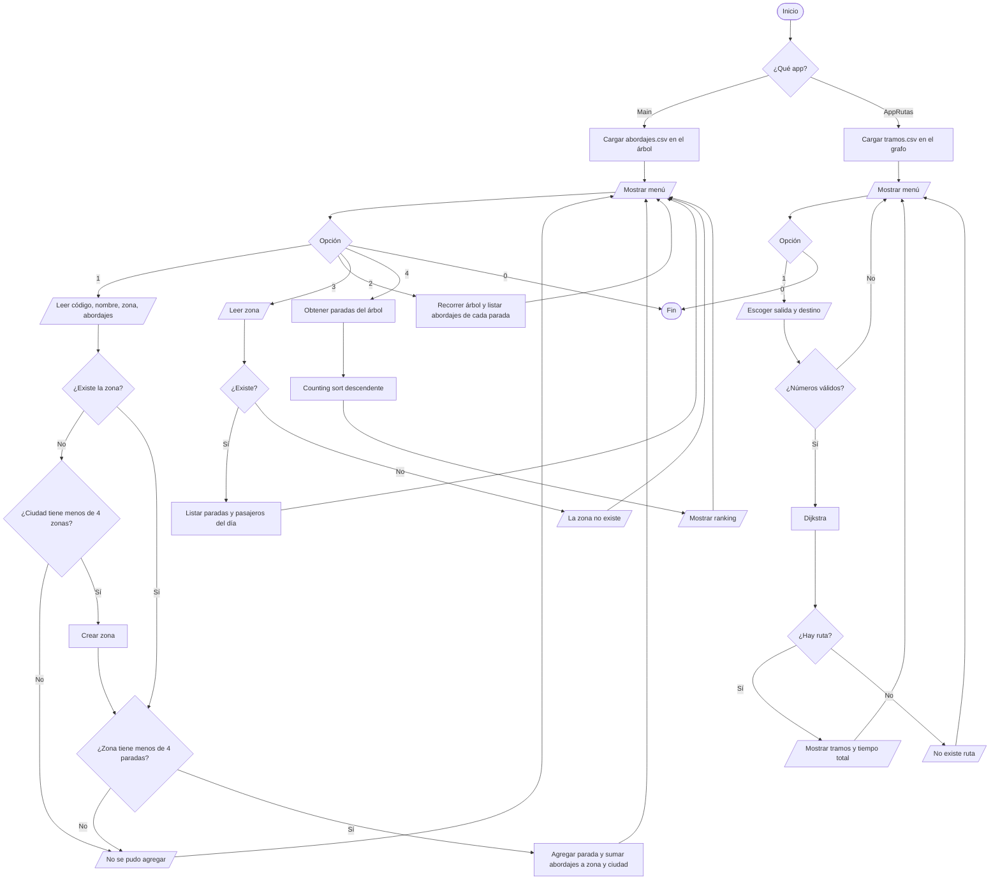
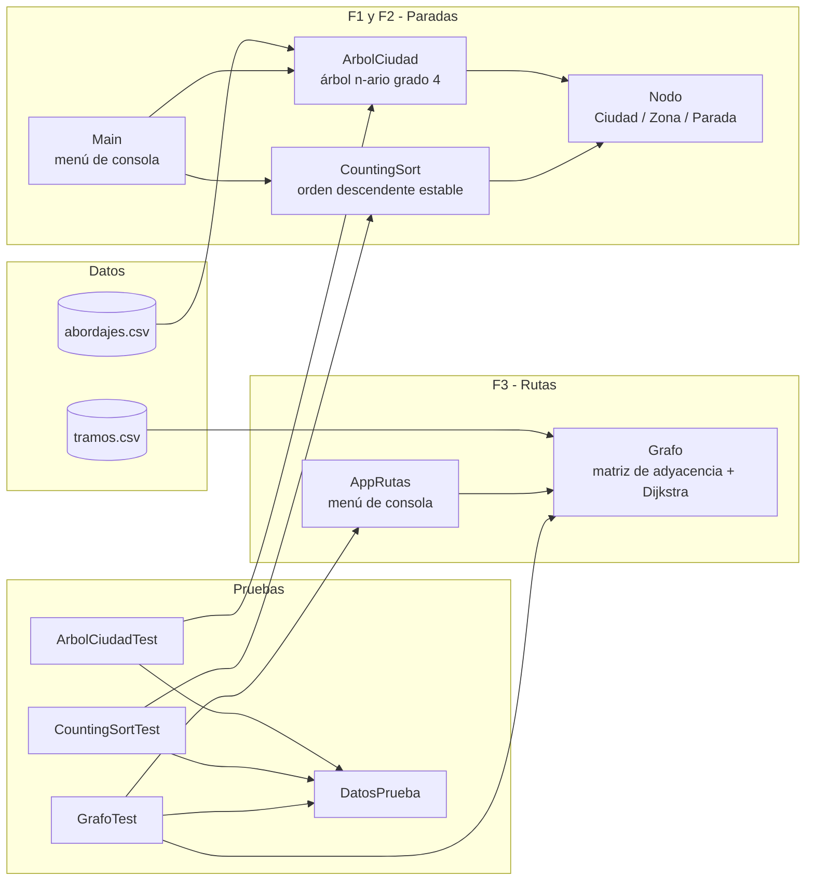
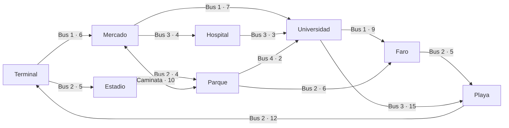
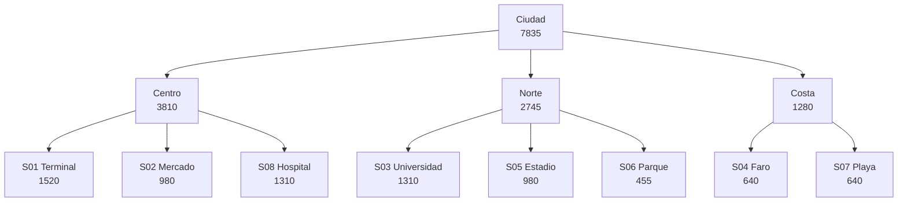

# Examen 2

## Autores

Paola Barquero y Daniel Vargas

## Requerimientos del sistema

F1
Funcionales

La oficina debe de poder agregar una a parada a zona, el árbol  n-ario.
Listar paradas de una zona, tomando la información desde el árbol
Obtener total abordajes desde el árbol
No funcionales
-Cada parada debe de pertenecer a una zona y cada zona a la ciudad. Ordenado en un árbol n-ario.
-Debe de registrar los abordajes diarios en el árbol

F2
Funcionales
-Ordenar abordajes de más a menos usando counting-sort.
-Debe de ser estable porque debe de estar listo para la peor tabla posible.

F3
Funcionales
-Debe de dar la ruta de menor tiempo posible cada vez al pasajero usando el grafo de Dijkstra.
-Se debe de poder escoger la parada de salida y de destino.

## Instalación y ejecución

### Requisitos

- Java JDK 11 o superior (`javac` y `java` en el PATH).
- JUnit 5 para las pruebas (el *JUnit Platform Console Standalone*, por ejemplo `junit-platform-console-standalone-1.10.2.jar`, en la carpeta `lib/`).

No se usa ninguna colección de `java.util` ni bibliotecas de grafos u ordenamiento: todas las estructuras están hechas con arreglos y `String`.

### Compilar

Desde la carpeta raíz del proyecto:

```bash
javac -encoding UTF-8 -d out src/*.java
```

### Ejecutar la app de paradas (F1 y F2)

```bash
java -cp out Main abordajes.csv
```

Menú:

1. Agregar parada (código, nombre, zona, abordajes).
2. Listar el total de abordajes de cada parada.
3. Listar las paradas de una zona.
4. Ordenar abordajes de mayor a menor (counting sort).
0. Salir.

### Ejecutar la app de rutas (F3)

```bash
java -cp out AppRutas tramos.csv
```

Menú:

1. Buscar ruta: se muestran las paradas numeradas, se escoge el número de la parada de salida y el de la parada de destino, y el sistema responde con la ruta más corta (tramos, línea, minutos y tiempo total).
0. Salir.

Si no se indica el archivo, ambas apps buscan `abordajes.csv` o `tramos.csv` en la carpeta actual.

### Ejecutar las pruebas

```bash
javac -encoding UTF-8 -d out -cp lib/junit-platform-console-standalone-1.10.2.jar src/*.java test/*.java
java -jar lib/junit-platform-console-standalone-1.10.2.jar -cp out --scan-classpath
```

Las pruebas no dependen de la carpeta de ejecución: `DatosPrueba` escribe una copia de los CSV en archivos temporales.

## Jerarquía de carpetas

```
examen/
├── README.md
├── abordajes.csv          Datos de paradas: codigo, parada, zona, abordajes
├── tramos.csv             Datos del grafo: linea, desde, hacia, minutos
├── lib/                   JUnit (junit-platform-console-standalone)
├── src/
│   ├── Nodo.java
│   ├── ArbolCiudad.java
│   ├── CountingSort.java
│   ├── Main.java
│   ├── Grafo.java
│   └── AppRutas.java
└── test/
    ├── DatosPrueba.java
    ├── ArbolCiudadTest.java
    ├── CountingSortTest.java
    └── GrafoTest.java
```

### Clases

| Clase | Descripción |
|---|---|
| `Nodo` | Nodo del árbol n-ario de cuarto grado. Guarda tipo (Ciudad, Zona o Parada), código, nombre, abordajes y un arreglo `Nodo[4]` de hijos. `agregarHijo` devuelve `false` si el nodo ya tiene 4 hijos. |
| `ArbolCiudad` | Árbol Ciudad → Zonas → Paradas. Carga `abordajes.csv`, agrega paradas (crea la zona si no existe), suma los abordajes del día en la zona y en la ciudad, lista los abordajes de cada parada, lista las paradas de una zona y devuelve todas las paradas en un arreglo. |
| `CountingSort` | Ordena un arreglo de paradas por abordajes de mayor a menor con counting sort estable (conteo, acumulado descendente y colocación recorriendo el arreglo al revés). |
| `Main` | Menú de consola para F1 y F2. |
| `Grafo` | Grafo dirigido y ponderado en minutos, con matriz de adyacencia `int[][]` y matriz de líneas `String[][]`. Carga `tramos.csv`; la caminata "(ambos sentidos)" se agrega en las dos direcciones. Implementa Dijkstra con arreglos (`distancia`, `previo`, `visitado`) y reconstruye la ruta. |
| `AppRutas` | Menú de consola para F3: escoger salida y destino y mostrar la ruta más corta. `describirRuta` arma el texto de respuesta. |
| `DatosPrueba` | Datos de prueba (copia de los CSV) escritos en archivos temporales. |
| `ArbolCiudadTest` | Pruebas de carga, agregar paradas, listar abordajes y listar paradas de una zona. |
| `CountingSortTest` | Pruebas del ordenamiento: valores exactos, empates (estabilidad), casos límite y entradas inválidas. |
| `GrafoTest` | Pruebas de la carga del grafo y de Dijkstra: rutas exactas, origen igual al destino, empates, sin ruta y paradas inexistentes. |

## Requerimientos desarrollados

| Requerimiento | Estado | Implementación | Pruebas |
|---|---|---|---|
| F1 – Agregar una parada a una zona en el árbol n-ario | Implementado | `ArbolCiudad.agregarParada` | `ArbolCiudadTest` (`agregar_*`) |
| F1 – Listar paradas de una zona desde el árbol | Implementado | `ArbolCiudad.listarParadasDeZona` | `ArbolCiudadTest` (`listarZona_*`) |
| F1 – Obtener total de abordajes desde el árbol | Implementado | `ArbolCiudad.listarAbordajes` | `ArbolCiudadTest` (`listarAbordajes_*`) |
| F1 (no funcional) – Parada pertenece a zona y zona a ciudad, en árbol n-ario | Implementado | `Nodo`, `ArbolCiudad` | `ArbolCiudadTest` (`carga_*`) |
| F1 (no funcional) – Registrar abordajes diarios en el árbol | Implementado | Abordajes en cada parada; suma diaria en zona y ciudad | `ArbolCiudadTest` (`carga_pasajerosDelDiaPorZonaYCiudad`) |
| F2 – Ordenar abordajes de más a menos con counting sort | Implementado | `CountingSort.ordenarDescendente` | `CountingSortTest` |
| F2 – Ordenamiento estable | Implementado | Colocación recorriendo el arreglo al revés | `CountingSortTest` (`limite_empatesConservanOrdenDelArbol`, `limite_todosIguales`) |
| F3 – Ruta de menor tiempo con el grafo y Dijkstra | Implementado | `Grafo.dijkstra` | `GrafoTest` (`dijkstra_*`) |
| F3 – Escoger parada de salida y de destino | Implementado | `AppRutas` | `GrafoTest` (`dijkstra_textoExactoDeLaApp`) |

**Requerimientos excluidos:** ninguno.

**Comportamientos conocidos:**

- Como el árbol es de cuarto grado, una zona admite como máximo 4 paradas y la ciudad como máximo 4 zonas; al superar ese límite, `agregarParada` devuelve `false`.
- Counting sort no admite abordajes negativos: lanza `ArrayIndexOutOfBoundsException`.

## Diagramas

### Diagrama de flujo



### Diagrama de componentes



### Diagrama del grafo

Aristas dirigidas con el peso en minutos. La caminata Mercado–Parque es la única arista en ambos sentidos.



### Árbol n-ario de la ciudad


